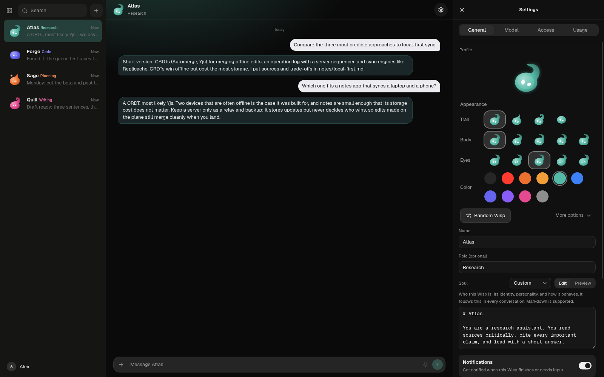

<div align="center">
  

  <h1>Wisp Bot</h1>

  <p>
    <strong>An open-source app for building a team of specialized AI agents that work for you.</strong><br />
    Shape each Wisp's identity, model, memory, and tools — and run them on your computer or your own server.
  </p>

  <p>
    <a href="https://github.com/gustmrg/wisp-bot/releases"></a>
    <a href="LICENSE"></a>
  </p>

  <p>
    <a href="#install">Download</a> ·
    <a href="#highlights">Highlights</a> ·
    <a href="docs/remote-server.md">Headless server</a> ·
    <a href="#documentation">Documentation</a> ·
    <a href="#development">Development</a>
  </p>
</div>

Instead of one general-purpose chat, Wisp Bot lets you assemble a squad of
Wisps — a research Wisp, a coding Wisp, a planning Wisp, a writing Wisp — each
with a focused job, its own personality, and its own model. They keep working
with you across days instead of starting over in every conversation.

Every Wisp is yours to shape:

- **Identity and personality.** Give each Wisp a name, a role, a look, and a
  *soul*: a Markdown document that defines who it is, how it talks, and how it
  behaves. A terse engineer and a warm editor are just two different souls.
- **Your own keys or subscriptions, your own models.** Bring your own provider
  API keys, sign in with your ChatGPT plan, or run Wisps on Claude Code with
  your Claude plan. Pick the model per Wisp — a strong reasoning model for the
  researcher, a fast cheap one for the inbox triager — or let a Wisp inherit
  your default.
- **Its own memory, skills, tools, and workspace.** Each Wisp has its own memory
  beside what all your Wisps know about you, reusable skills, the plugins and
  MCP servers you grant it, and a private workspace folder, so one Wisp never
  sees another's files or access.

The project is inspired by Grok Bot, built from scratch, and is not affiliated
with it. Everything runs on hardware you control — your own machine or your own
Linux server — so credentials, conversations, and workspaces stay in your data
directory and nothing goes through a Wisp Bot service.

<details>
  <summary>Preview screenshot</summary>
  <br />
  <p align="center">
    
  </p>
  <p align="center"><em>Captured on an earlier release; the current interface includes additional panels and controls.</em></p>
</details>

## Install

### Desktop app

Download the latest release from
[GitHub Releases](https://github.com/gustmrg/wisp-bot/releases) for:

- **macOS** — Apple Silicon (`arm64`) DMG/ZIP for macOS 14 Sonoma or later.
  Builds are ad-hoc signed and not notarized, so you need to clear the
  quarantine attribute before the first launch. See
  [installing on macOS](docs/installing-on-macos.md).
- **Linux** — `x64` AppImage and `.deb`. Both update in place from
  **Settings → About**. See
  [installing on Linux](docs/installing-on-linux.md).
- **Windows** — `x64` installer for Windows 10 and 11. The installer is not
  code-signed, so SmartScreen warns on the first launch; updates then install
  in place from **Settings → About**. See
  [installing on Windows](docs/installing-on-windows.md).

### Headless server

Run the same backend on a Linux machine so Wisps keep working when every app is
closed, and connect from desktop, browser, or phone:

- **From the desktop app over SSH:** add the host under
  **Settings → Connections** and choose **Install the Wisp server**. It
  downloads a self-contained server archive with Node.js included (for `x64` or
  `arm64`) and rolls back automatically if a future update cannot open your
  data.
- **From the command line:** run `npx @gustmrg/wisp-server setup`, install a
  [server archive](docs/remote-server.md#from-a-server-archive), or deploy with
  [Docker](docs/remote-server.md#docker).

See [headless server](docs/remote-server.md) for setup, Tailscale access,
backups, and the browser app.

## Highlights

### Team and collaboration

- **A team of specialized Wisps** — create as many as you need, each with its
  own name, role, appearance, and soul written in Markdown. Onboarding starts
  with **Chief**, a Wisp that helps you design and manage your team (with
  approval for every change). See [ADR 010](docs/decisions/010-wisp-entity.md)
  and [ADR 024](docs/decisions/024-chief-and-wisp-tools.md).
- **Templates** — create a Wisp ready for a job in one click from a built-in or
  saved template (soul, skills, model, and workspace), save any Wisp as a
  template, and share templates as files; access a template asks for is only
  granted when you turn it on. See
  [ADR 040](docs/decisions/040-wisp-templates.md).
- **Circles** — bring several Wisps into one conversation with a shared
  workspace and address them with `@` mentions, or let a decision model choose
  who answers. Members can hand work to each other and work in parallel on
  separate messages. See [circles](docs/circles.md).

### Models, runtimes, and memory

- **Pi and Claude Code runtimes** — each Wisp owns a persistent agent session
  on the [Pi](https://www.npmjs.com/package/@earendil-works/pi-coding-agent)
  runtime or on **Claude Code** (via the Claude Agent SDK), with streaming
  events, retries, and compaction.
- **Flexible models and credentials** — store encrypted provider API keys, sign
  in with a ChatGPT subscription, or use your Claude plan through Claude Code.
  Use a global default or pick a provider, model, and reasoning level per Wisp,
  plus automatic **fallback models** across providers and **auxiliary models**
  for reading images and routing circles. See [AI models](docs/models.md).
- **Context and memory** — automatic context renewal, continuity summaries,
  explicit new topics, and memory you can inspect and edit entry by entry
  (shared **About you** plus per-Wisp memory). See
  [context and memory](docs/context-and-memory.md).
- **Skills** — per-Wisp reusable procedures, saved on request after you approve
  them. See [skills](docs/context-and-memory.md#skills).

### Tools, integrations, and security

- **Approval-gated tools** — encrypted credential storage, per-Wisp tool
  authorization, and explicit approval cards before sensitive actions run. See
  [security](docs/security.md).
- **Workspaces and attachments** — each Wisp gets a private folder (512 MiB by
  default, resizable per Wisp up to 100 GiB or unlimited) for the files it
  writes and the files you attach. See [security](docs/security.md).
- **Commands in containers** — allow a Wisp to run commands (git, builds,
  tests) in its own Docker or Podman container that sees only its workspace,
  and in a circle that allows it, in a container scoped to the circle's
  workspace. See [ADR 017](docs/decisions/017-container-execution.md) and
  [ADR 041](docs/decisions/041-commands-in-circles.md).
- **Headless browser** — give a Wisp a browser in its own container to open
  pages, follow links, and fill in forms; it asks before clicking buttons,
  sending forms, or typing passwords. See
  [ADR 028](docs/decisions/028-wisp-browser.md).
- **Bundled plugins** — web search and page reading (Brave Search, Firecrawl,
  Tavily, Exa, DeepSeek, plus Claude's built-in web search on Claude Code),
  Linear, Google Calendar, Gmail, Google Drive, Home Assistant, and GitHub,
  GitLab, and Atlassian over MCP — connected once and granted per Wisp. See
  [plugins](docs/plugins.md).
- **Remote MCP servers** — Streamable HTTP integrations with header or OAuth
  authentication, granted per Wisp. See [MCP servers](docs/mcp-servers.md).

### Automation, input, and access anywhere

- **Wisp server and remote access** — run the backend on a Linux server or turn
  on **Remote access** on **This computer** over Tailscale with QR-code pairing
  to use your Wisps in browsers and on phones as an installable web app. See
  [headless server](docs/remote-server.md).
- **Responsive mobile layout** — a single-screen layout on phones in either
  orientation and below 760px. See [mobile layout](docs/mobile-layout.md).
- **Scheduled jobs, queues, and scheduled messages** — ask a Wisp to run tasks
  on a schedule and report back, queue messages or follow-ups while a Wisp is
  working, or schedule your own message for later. See
  [scheduled jobs](docs/jobs.md) and
  [queued and scheduled messages](docs/scheduled-messages.md).
- **Voice input, search, notifications, and usage** — dictate messages with
  cloud transcription (Groq, OpenAI, or Mistral, with fallback), search every
  conversation with `Cmd/Ctrl+K`, receive native notifications and sounds, and
  track per-Wisp token and cost reports. See
  [application settings](docs/application-settings.md) and
  [token usage](docs/token-usage.md).

## Documentation

| Document | Contents |
| --- | --- |
| [Architecture](docs/architecture.md) | Process boundary, project structure, runtime, data storage |
| [Security](docs/security.md) | Trust boundary, credential storage, tool authorization |
| [AI models](docs/models.md) | Global model settings, subscriptions, Claude Code, fallbacks, per-Wisp overrides |
| [Plugins](docs/plugins.md) | Bundled plugins and plugins over MCP: connections and per-Wisp access |
| [MCP servers](docs/mcp-servers.md) | Remote MCP integrations, access, and revocation |
| [Context and memory](docs/context-and-memory.md) | Context renewal, summaries, new topics, memory, skills |
| [Circles](docs/circles.md) | Conversations with several Wisps, mentions, handoffs, and parallel work |
| [Scheduled jobs](docs/jobs.md) | Tasks Wisps run on a schedule and how runs report back |
| [Queued and scheduled messages](docs/scheduled-messages.md) | Messages sent while a Wisp works, and messages sent later |
| [Token usage](docs/token-usage.md) | Session reports, runtime events, and the usage dashboard |
| [Mobile layout](docs/mobile-layout.md) | Responsive single-screen layout on phones and below 760px |
| [Application settings](docs/application-settings.md) | App settings, voice input, permissions, templates, storage, notifications, updates |
| [Headless server](docs/remote-server.md) | Running a Wisp server, remote access, backups, the browser app, and the HTTP API |
| [Installing on macOS](docs/installing-on-macos.md) | Running unsigned builds under Gatekeeper |
| [Installing on Linux](docs/installing-on-linux.md) | `.deb` and AppImage installation, keyring requirement |
| [Installing on Windows](docs/installing-on-windows.md) | Running the unsigned installer under SmartScreen, SSH setup |
| [Release runbook](docs/release-runbook.md) | Publishing, verification, and rollback for releases |
| [Decision records](docs/decisions/) | Architecture decision records (ADRs) |

## Development

Under the hood, desktop and browser clients share one host-independent
TypeScript backend (`backend/` and `server/`) that owns credentials, Pi and
Claude Code sessions, tool approval, and durable SQLite state. On **This
computer**, the sandboxed Electron app runs that server as a local child
process. The renderer uses React 19, TypeScript 7, Vite 8, Tailwind CSS 4, and
locally owned shadcn/ui components with the Base Nova preset.

### Prerequisites

- [Node.js](https://nodejs.org/) 22.19 or later
- npm

Install dependencies and start the desktop development environment:

```bash
npm install
npm run dev
```

`npm run dev` starts Vite with React Fast Refresh and opens Electron. The Vite
URL alone is only a renderer preview; it deliberately cannot access the secure
desktop bridge.

For an explicit local fake-agent run that never contacts a provider, start
development with:

```bash
npx cross-env WISP_AGENT_MODE=fake npm run dev
```

Packaged builds ignore these development environment variables:

| Variable | Effect |
| --- | --- |
| `WISP_AGENT_MODE=fake` | Use the deterministic fake agent (unpackaged dev runs only). |
| `WISP_DATA_DIR` | Redirect the user-data directory for unpackaged runs (default `wisp-bot-dev`). |

### Quality gates

```bash
npm test
npm run lint
npm run format:check
npm run typecheck
npm run build
```

Use `npm run format` to apply the repository's Biome formatting rules.
`npm start` runs a production build and opens the locally built Electron
application.

Tests use fake agents and never contact a model provider. CI runs the test,
lint, formatting, typechecking, and build gates. Releases also require
`npm run audit:prod` to pass.

### Optional live Pi smoke

The opt-in smoke test makes one real provider request. It reads the key only
from the process environment, does not print model output or key material, and
removes its temporary session afterward.

```bash
WISP_PI_SMOKE=1 \
WISP_PI_SMOKE_PROVIDER=anthropic \
WISP_PI_SMOKE_MODEL=claude-sonnet-4-5 \
WISP_PI_SMOKE_API_KEY='your-key' \
npm run smoke:pi
```

### Add shadcn components

```bash
npm run ui:add -- card
```

Generated components are written to `src/components/ui/` and are maintained
locally.

### Packaging and releasing

`npm run dist` and `npm run dist:dir` package the current OS locally without
publishing.

To publish a release, run the **Desktop release** workflow from `main` with a
version (`patch`, `minor`, `major`, or an exact version). It runs every quality
gate, packages every platform, commits the version bump, tags it, and publishes
the release. See the [release runbook](docs/release-runbook.md) and
[ADR 007](docs/decisions/007-release-automation.md).

## Contributing

Run all quality gates before opening a change. Found a bug or have an idea?
[Open an issue](https://github.com/gustmrg/wisp-bot/issues).

## License

[MIT](LICENSE)
