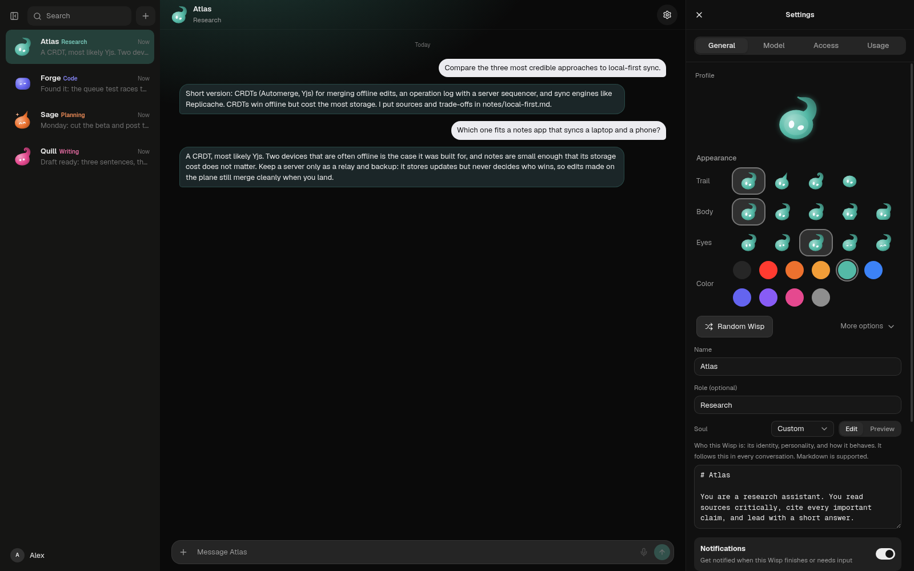
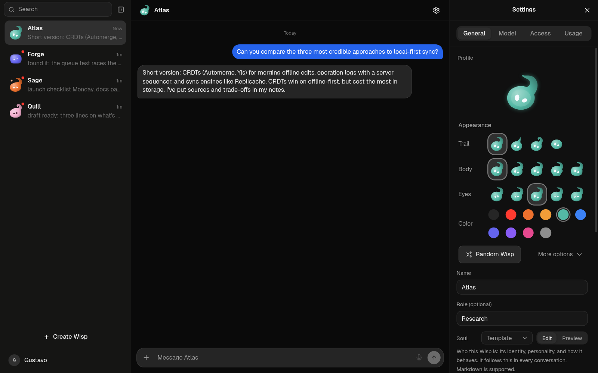

# Wisp Bot

Wisp Bot is an open-source app for building a **team of specialized AI agents
that work for you**. Instead of one general-purpose chat, you assemble a squad
of Wisps — a research Wisp, a coding Wisp, a planning Wisp, a writing Wisp —
each with a focused job, its own personality, and its own model. They keep
working with you across days instead of starting over in every conversation.

Every Wisp is yours to shape:

- **Identity and personality.** Give each Wisp a name, a role, a look, and a
  *soul*: a Markdown document that defines who it is, how it talks, and how it
  behaves. A terse engineer and a warm editor are just two different souls.
- **Your own keys, your own models.** You bring your own provider API keys and
  pick the model per Wisp — a strong reasoning model for the researcher, a fast
  cheap one for the inbox triager — or let a Wisp inherit your default.
- **Its own memory, skills, tools, and workspace.** Each Wisp has its own memory
  beside what all your Wisps know about you, reusable skills, the plugins and MCP servers you grant it, and a private
  workspace folder, so one Wisp never sees another's files or access.

The project is inspired by Grok Bot but built from scratch and is not affiliated
with it. The app runs on your own machine: provider keys, conversations,
credentials, and workspaces stay in your local user-data directory, and nothing
goes through a Wisp Bot service.

<p align="center">
  
</p>

<p align="center">
  
</p>

Under the hood, each Wisp owns a persistent agent session on the
[Pi](https://www.npmjs.com/package/@earendil-works/pi-coding-agent) runtime,
while a sandboxed Electron main process owns credentials, sessions, tool
approval, and durable state. The renderer uses React 19, TypeScript 7, Vite 8,
Tailwind CSS 4, and locally owned shadcn/ui components with the Base Nova
preset.

## Highlights

- **A team of specialized Wisps** — create as many as you need, each with its
  own name, role, appearance, and soul (its personality and behavior, written
  in Markdown with starting templates). See
  [ADR 010](docs/decisions/010-wisp-entity.md).
- **Bring your own keys, model per Wisp** — provider keys are stored encrypted
  and shared; each Wisp can use the global model or its own provider, model,
  and reasoning level. See [AI models](docs/models.md).
- **Persistent agent conversations** — one durable Pi session per Wisp, with
  streaming events, retries, and compaction.
- **Bundled plugins** — web search and page reading (Brave Search,
  Firecrawl, Tavily, Exa, DeepSeek), Linear, Google Calendar, Gmail, Google
  Drive, Home Assistant, and GitHub, GitLab, and Atlassian over MCP, connected
  once and granted per Wisp. See [plugins](docs/plugins.md).
- **Remote MCP servers** — Streamable HTTP integrations with header or OAuth
  authentication, granted per Wisp. See [MCP servers](docs/mcp-servers.md).
- **Context and memory** — continuity summaries, explicit new topics, and
  memory you can see and edit, entry by entry. See [context and memory](docs/context-and-memory.md).
- **Workspaces and attachments** — each Wisp gets a private folder (512 MB by
  default, resizable per Wisp up to 100 GB) for the files it writes and the
  files you attach. See
  [security](docs/security.md).
- **Commands** — a Wisp can be allowed to run commands (git, builds, tests) in
  its own Docker or Podman container that sees only its workspace. See
  [ADR 017](docs/decisions/017-container-execution.md).
- **Browser** — a Wisp can be given a headless browser, in a container of its
  own, to open pages, follow links and fill in forms; it asks before clicking
  buttons, sending forms or typing passwords. See
  [ADR 028](docs/decisions/028-wisp-browser.md).
- **Circles** — bring several Wisps into one conversation and address them
  with `@` mentions; they answer one at a time and can hand work to each
  other. See [circles](docs/circles.md).
- **Scheduled jobs and messages** — ask a Wisp to run a task on a schedule
  and report back, or schedule your own message for later. See
  [scheduled jobs](docs/jobs.md) and
  [scheduled messages](docs/scheduled-messages.md).
- **Message search** — search every conversation with `Cmd/Ctrl+K` and jump to
  the matching message.
- **Skills** — per-Wisp reusable procedures, saved on request after you
  approve them. See [context and memory](docs/context-and-memory.md#skills).
- **Usage reports** — per-Wisp session reports and a local token/cost
  dashboard. See [token usage](docs/token-usage.md).
- **Approval-gated tools** — encrypted credential storage and per-Wisp tool
  authorization. See [security](docs/security.md).
- **Responsive layout** — a mobile-style single-screen layout below 760px.
  See [mobile layout](docs/mobile-layout.md).
- **Wisp server** — run the same backend on a Linux machine and connect the
  app over SSH or Tailscale, so Wisps keep working with the app closed. One
  command, `npx @gustmrg/wisp-server setup`, installs it, or the app can do it
  over SSH. The server also serves the app to browsers and phones as an
  installable web app. See [headless server](docs/remote-server.md).

## Getting started

### Prerequisites

- [Node.js](https://nodejs.org/) 22.19 or later
- npm

Install dependencies and start the desktop development environment:

```bash
npm install
npm run dev
```

`npm run dev` starts Vite with React Fast Refresh and opens Electron. The Vite
URL alone is only a renderer preview; it deliberately cannot access the secure
desktop bridge.

For an explicit local fake-agent run that never contacts a provider, start
development with `WISP_AGENT_MODE=fake npm run dev`. Packaged builds ignore
this switch.

Development-only environment variables (all ignored by packaged builds unless
noted):

| Variable | Effect |
| --- | --- |
| `WISP_AGENT_MODE=fake` | Use the deterministic fake agent (unpackaged dev runs only). |
| `WISP_DATA_DIR` | Redirect the user-data directory for unpackaged runs (default `wisp-bot-dev`). |

### Quality gates

```bash
npm test
npm run lint
npm run format:check
npm run typecheck
npm run build
```

Use `npm run format` to apply the repository's Biome formatting rules.
`npm start` runs a production build and opens the locally built Electron
application.

Tests use fake agents and never contact a model provider. CI runs the test,
lint, formatting, typechecking, and build gates. Releases also require
`npm run audit:prod` to pass.

### Optional live Pi smoke

The opt-in smoke test makes one real provider request. It reads the key only
from the process environment, does not print model output or key material, and
removes its temporary session afterward.

```bash
WISP_PI_SMOKE=1 \
WISP_PI_SMOKE_PROVIDER=anthropic \
WISP_PI_SMOKE_MODEL=claude-sonnet-4-5 \
WISP_PI_SMOKE_API_KEY='your-key' \
npm run smoke:pi
```

### Add shadcn components

```bash
npm run ui:add -- card
```

Generated components are written to `src/components/ui/` and are maintained
locally.

## Documentation

| Document | Contents |
| --- | --- |
| [Architecture](docs/architecture.md) | Process boundary, project structure, runtime, data storage |
| [Security](docs/security.md) | Trust boundary, credential storage, tool authorization |
| [AI models](docs/models.md) | Global model settings and per-Wisp overrides |
| [Plugins](docs/plugins.md) | Bundled plugins and plugins over MCP: connections and per-Wisp access |
| [MCP servers](docs/mcp-servers.md) | Remote MCP integrations, access, and revocation |
| [Context and memory](docs/context-and-memory.md) | Context renewal, summaries, new topics, memory, skills |
| [Circles](docs/circles.md) | Conversations with several Wisps, mentions, and handoffs |
| [Scheduled jobs](docs/jobs.md) | Tasks Wisps run on a schedule and how runs report back |
| [Queued and scheduled messages](docs/scheduled-messages.md) | Messages sent while a Wisp works, and messages sent later |
| [Token usage](docs/token-usage.md) | Session reports and the usage dashboard |
| [Mobile layout](docs/mobile-layout.md) | Responsive single-screen layout below 760px |
| [Application settings](docs/application-settings.md) | App settings, voice input, storage, notifications, updates, known limitations |
| [Headless server](docs/remote-server.md) | Running a Wisp server, connecting to it, backups, the browser app, and the HTTP API |
| [Installing on macOS](docs/installing-on-macos.md) | Running unsigned builds under Gatekeeper |
| [Installing on Linux](docs/installing-on-linux.md) | `.deb` and AppImage installation, keyring requirement |
| [Release runbook](docs/release-runbook.md) | Publishing, verification, and rollback for releases |
| [Decision records](docs/decisions/) | Architecture decision records (ADRs) |

## Desktop releases

[GitHub Releases](https://github.com/gustmrg/wisp-bot/releases) has macOS
(Apple Silicon arm64 DMG/ZIP, macOS 14 Sonoma or later) and Linux (x64 AppImage and `.deb`) builds. Windows is
not built yet.

macOS builds are ad-hoc signed and not notarized, so you have to remove the
quarantine attribute before the first launch. See
[installing on macOS](docs/installing-on-macos.md). Linux builds update in
place from Settings → About. See [installing on Linux](docs/installing-on-linux.md).

To release, run the **Desktop release** workflow from `main` with a version
(`patch`, `minor`, `major`, or an exact version). It runs every quality gate,
packages both platforms, commits the version bump, tags it, and publishes the
release. See the [release runbook](docs/release-runbook.md) and
[ADR 007](docs/decisions/007-release-automation.md). `npm run dist` and
`npm run dist:dir` package the current OS locally without publishing.

## Contributing

Run all quality gates before opening a change. Found a bug or have an idea?
[Open an issue](https://github.com/gustmrg/wisp-bot/issues).

## License

[MIT](LICENSE)
